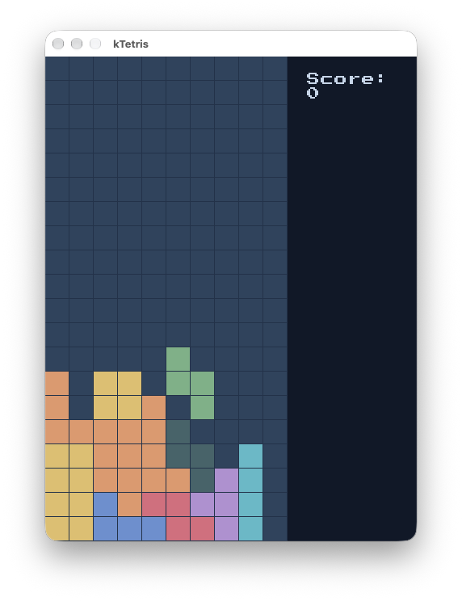

# kTetris

A small falling-block game written in C with raylib.



## Controls

| Key | Action |
| --- | --- |
| ← / → | Move the piece left or right |
| ↑ | Rotate the piece |
| ↓ | Soft drop |
| Space | Hard drop |
| Enter | Restart after game over |

## Build and run

You will need CMake 3.22 or newer, Git and a C/C++ toolchain.

```sh
cmake -B build
cmake --build build
```

```sh
./build/tetris
```

## Font

The game uses Press Start 2P, licensed under the SIL Open Font License 1.1.
See [resources/OFL.txt](resources/OFL.txt) for the license text.